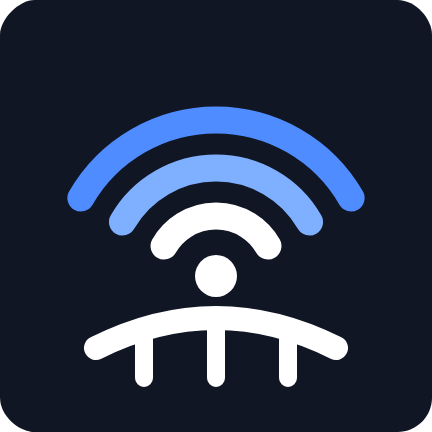
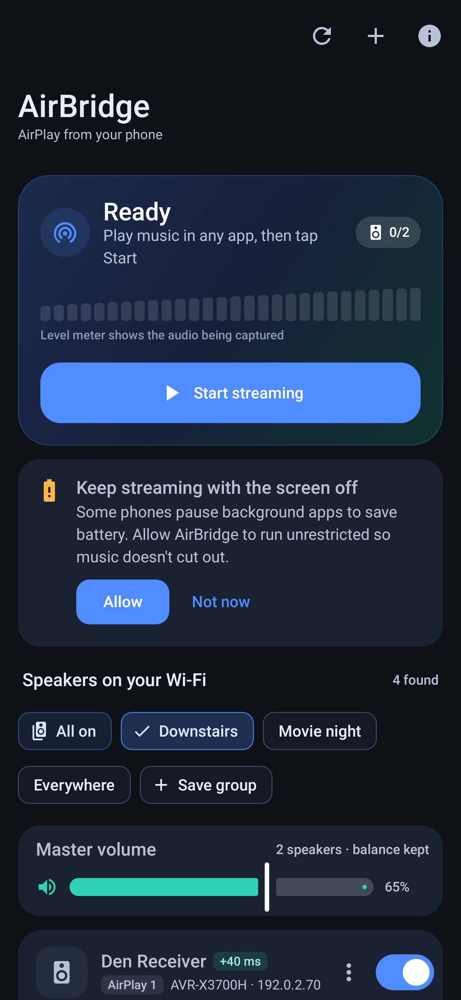
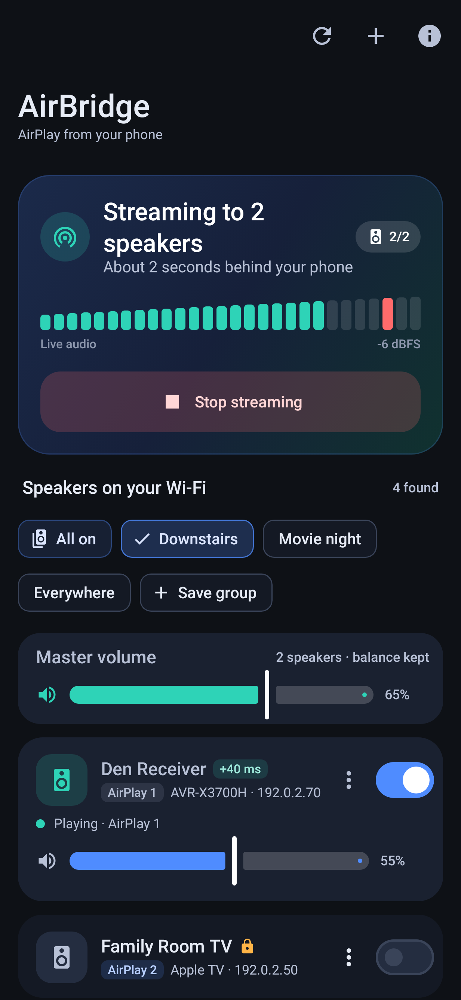
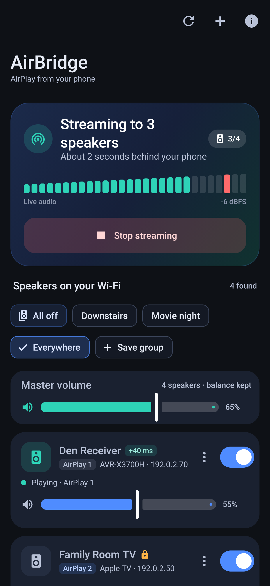
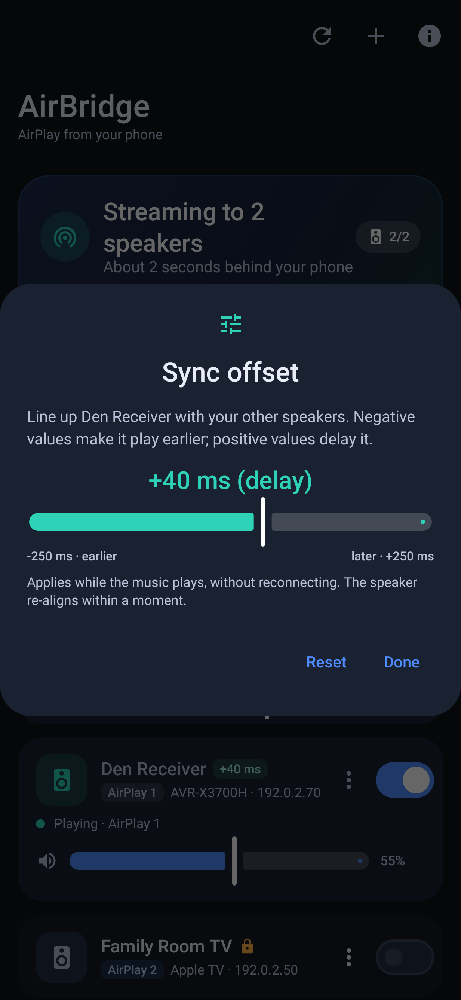
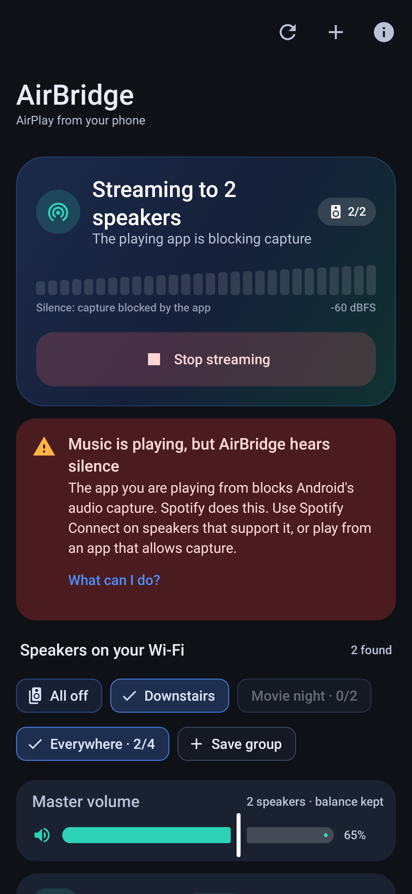

# AirBridge

AirBridge is an Android app that streams the audio playing on your phone to AirPlay speakers over
your local Wi-Fi. It is an AirPlay 1 (RAOP) and AirPlay 2 (HAP pairing) sender for Android 10 and
newer, written in Kotlin with Jetpack Compose.

- **AirPlay 1 and AirPlay 2 in one app:** RAOP for older receivers, and AirPlay 2 with HomeKit
  (HAP) pairing, including the on-screen code of an Apple TV and password-protected speakers.
  Designed for Sonos, HomePod, Apple TV, Denon/Marantz/Yamaha receivers, WiiM, AirPort Express,
  Shairport-Sync and other AirPlay receivers (not yet tested on real hardware; see
  [Status and limitations](#status-and-limitations)).
- **Multi-speaker:** play to several speakers at once, all on one shared clock. A slow or
  disconnected speaker does not hold up the others.
- **Per-speaker volume and a master volume:** each speaker has its own slider, and the master
  slider moves every speaker that is on while keeping their balance (new in v0.2.0).
- **Per-speaker sync offset (new in v0.2.0):** shift one speaker by up to 250 ms earlier or later,
  in 5 ms steps, to line it up with the others. The change applies while the music plays, without
  reconnecting.
- **Saved speaker groups and All on / All off (new in v0.2.0):** save the speakers that are on as
  a group such as "Downstairs", then tap the group to play exactly those speakers. One tap turns
  every speaker on or off, also while streaming.
- **100% local Wi-Fi:** the only network traffic is mDNS discovery and AirPlay to the speakers on
  your network. No account, cloud service, analytics or ads.

> [!IMPORTANT]
> **Spotify cannot be streamed with AirBridge.** Spotify blocks Android's `AudioPlaybackCapture`
> API, so Android gives every capture app, AirBridge included, digital silence while Spotify plays.
> AirBridge detects this within about 3 seconds and shows a red banner that explains why. For
> Spotify, use Spotify Connect on speakers that support it (Sonos, Denon/Marantz HEOS, Yamaha
> MusicCast, WiiM and others). AirBridge works with apps that allow capture: most local music
> players, many podcast apps, and browsers for some sites.

## Screenshots

| Ready | Streaming a saved group | Every speaker on |
|:---:|:---:|:---:|
|  |  |  |

| Sync offset | Capture blocked (Spotify) |
|:---:|:---:|
|  |  |

The screenshots are rendered from the real Compose UI with sample speakers and addresses from the
192.0.2.0/24 documentation range (see [docs/BUILD-TEST-REPORT.md](docs/BUILD-TEST-REPORT.md)).

## Quick install (Android phone)

1. On your Android phone, open the
   [v0.2.0-debug release](https://github.com/edge-sentinel-crypto/airbridge-android/releases/tag/v0.2.0-debug)
   and download **`AirBridge-debug.apk`** (about 29 MB). Direct link:
   <https://github.com/edge-sentinel-crypto/airbridge-android/releases/download/v0.2.0-debug/AirBridge-debug.apk>
2. Open the downloaded file. When Android asks, allow installs from that source.
3. Tap **Install**, then **Open**. Play Protect may warn about an unknown developer, because this
   build is signed with the standard Android debug key, not a Play Store key; tap
   **More details > Install anyway**.
4. Turn on the speakers you want, start music in another app, and tap **Start streaming**.

Already have v0.1.0-debug? Install v0.2.0-debug over it. It has the same package name and the same
signing key, so Android updates the app in place and keeps your speakers, volumes and pairings.

SHA-256 of `AirBridge-debug.apk` (v0.2.0-debug, 29,284,516 bytes):

```
d4f047de85ba79afa138434ab0897aa55f9828c3cf446b09ea9cceb76c3ee0e2
```

Full instructions (checking the hash, copying from a computer, ADB, first-run permissions,
troubleshooting): [docs/INSTALL.md](docs/INSTALL.md).

## Build from source

Requirements: JDK 17 and the Android SDK with Platform 35 (`platforms;android-35`) and Build-Tools
35.0.0. Set `JAVA_HOME`, and set `ANDROID_HOME` (or put `sdk.dir=<path to the SDK>` in
`local.properties`).

```bash
git clone https://github.com/edge-sentinel-crypto/airbridge-android.git
cd airbridge-android
./gradlew testDebugUnitTest assembleDebug lintDebug
```

- `testDebugUnitTest` runs 115 unit and loopback integration tests, including complete AirPlay 1 and
  AirPlay 2 sessions against mock receivers over real sockets on 127.0.0.1, and the v0.2.0
  multi-room features (master volume, sync offset, groups, All on / All off) driving live mock
  speakers. Two interop tests use FFmpeg and Python when they are installed and are skipped
  otherwise.
- `assembleDebug` writes `app/build/outputs/apk/debug/app-debug.apk`. It is signed with your own
  debug key, so its SHA-256 differs from the release APK.
- `lintDebug` runs Android lint with `abortOnError = true`.

The build is tested on Linux (Ubuntu 24.04 under WSL2). Step-by-step toolchain setup on Linux or
WSL, without sudo: [docs/INSTALL.md, section 7](docs/INSTALL.md#7-building-the-apk-from-source).
On Windows, `gradlew.bat` replaces `./gradlew` (not tested).

## How it works

1. Android's AudioPlaybackCapture API gives AirBridge the audio other apps play, as 44.1 kHz 16-bit
   stereo. Android asks for your consent each time you start streaming. AirBridge never uses the
   microphone, although Android requires the `RECORD_AUDIO` permission for capture.
2. A foreground service with a notification and a Stop button keeps streaming with the screen off.
   (Some Android versions end capture when the phone locks; AirBridge then stops and says so.)
3. Speakers are found with mDNS (`_raop._tcp` and `_airplay._tcp`), or added by IP address.
4. The audio is encoded once as ALAC (plain PCM for receivers that accept only PCM) and sent to
   every selected speaker, each with its own connection and thread, on one shared timeline.
5. Speakers play about 2 seconds behind the phone (the AirPlay network buffer), so AirBridge suits
   music, not lip-sync with video.
6. A speaker's sync offset changes only the delay AirBridge announces to that speaker in its RTP
   sync packets: -250 ms plays it earlier, +250 ms later (1.75 to 2.25 s in total).

Details: [docs/PLAN.md](docs/PLAN.md).

## Status and limitations

- **Not yet tested on real hardware.** The protocol engine is covered by the automated tests above,
  but no real phone or speaker was used in this build. Whether each speaker model accepts the
  AirPlay 2 session still needs checking on real devices.
- **AirPlay 2 timing uses NTP, not PTP.** PTP needs UDP ports 319/320, which Android apps cannot
  open without root. Receivers that reject NTP fall back to AirPlay 1 automatically when they offer
  it, and each speaker's menu can force AirPlay 1.
- **Sync offset and AirPlay 2.** Changing a speaker's offset mid-stream sends a new sync packet
  at once; whether every receiver model re-aligns smoothly (or skips briefly) still needs checking
  on real hardware. For AirPlay 2 speakers, a positive offset asks for up to 250 ms more delay than
  the 2-second maximum announced when the stream is set up.
- **Debug build.** The APK reports versionName 0.2.0 (versionCode 2) and is published as release
  `v0.2.0-debug`. (The first release, `v0.1.0-debug`, reported versionName 1.0.0 and versionCode 1.)
- More in [docs/PLAN.md, section 12](docs/PLAN.md#12-limitations-and-risks).

## Documentation

- [docs/PLAN.md](docs/PLAN.md): plan and architecture (capture, discovery, AirPlay 1 and 2 engines,
  multi-speaker timing, master volume, sync offset, groups, privacy).
- [docs/INSTALL.md](docs/INSTALL.md): installing, first run, everyday use, troubleshooting, building
  from source.
- [docs/BUILD-TEST-REPORT.md](docs/BUILD-TEST-REPORT.md): build and test report (115 tests, lint,
  APK inspection, SHA-256 values).

## Acknowledgements

Protocol details were checked against the source of owntone, pyatv and Shairport-Sync and against
Apple's HomeKit ADK; see
[docs/BUILD-TEST-REPORT.md, section 5](docs/BUILD-TEST-REPORT.md#5-independent-cross-checks-used-during-the-build).

## License

MIT. See [LICENSE](LICENSE).

AirPlay, Apple TV and HomePod are trademarks of Apple Inc. Sonos and Spotify are trademarks of their
owners. AirBridge is an independent project and is not affiliated with or endorsed by Apple, Sonos
or Spotify.
